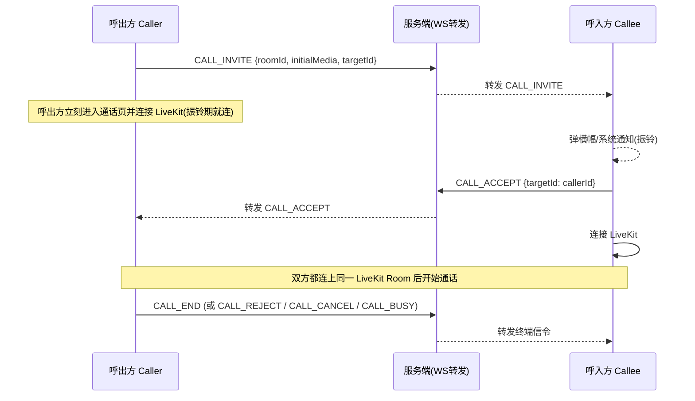

# Anoxia 音视频通话 · 流程与 UI/UX 设计文档（草稿 v0.1）

> 状态：**待评审**。本文档由代码调研整理而来，用于梳理"语音/视频通话"在各个端（Android / iOS / Windows / macOS / Linux / Web）的**流程**与 **UI/UX**。
> 用法：你先通读、在任意位置修改，标注你对每一节的取舍（保留 / 修改 / 砍掉），然后我们按文档逐期实现。
> 建议阅读顺序：`§1 现状` → `§2 目标总览` → `§3 流程设计` → `§4 UI/UX 规范` → `§5 一致性矩阵` → `§6 实施计划` → `§7 待确认问题`。

---

## 0. 文档说明

### 0.1 目的

当前通话功能在**信令流程**和**各端体验**上存在不一致（详见 §1.4），本文档目标是：

1. 把现有实现完整梳理一遍（As-Is），让"第一次做这个"的你有一个全局视角；
2. 参考 Microsoft Teams 的通话交互，定义一套**统一的通话状态机 + 分端 UI/UX 规范**（To-Be）；
3. 形成可评审、可逐条实施的清单。

### 0.2 术语表

| 术语 | 含义 |
| --- | --- |
| 信令 | 控制通话状态的消息（来电、接听、挂断…），走 IM WebSocket 高频通道 `HIGH_FREQUENCY`，子类型 `HighMessageType.CALL_*` |
| 媒体 | 音视频流本身，由 LiveKit（WebRTC SFU）承载 |
| 呼出方 / Caller | 主动发起通话的人 |
| 呼入方 / Callee | 收到来电的人 |
| 房间 | 一次通话对应一个 LiveKit Room（命名即 IM 的 `roomId`） |
| PiP | 画中画（系统级小窗，仅 Android/iOS） |
| 浮窗 | 应用内自绘的可拖拽小窗（移动/Web） |
| 单人通话 / 1:1 | 单聊房间的通话 |
| 群通话 / 群呼 | 群聊房间的通话，成员可随时加入/离开 |

### 0.3 技术底座（现状，勿动）

- 媒体：**LiveKit**（`livekit_client ^2.7.0` + `flutter_webrtc ^1.4.0`），服务端 `/call/token` 签发 JWT、`/call/join` 创建房间并签发。
- 信令：IM WebSocket 高频通道，`HighMessageType` 的 `CALL_INVITE / CALL_ACCEPT / CALL_REJECT / CALL_CANCEL / CALL_END / CALL_BUSY`，payload 为 JSON（见 §1.2）。
- 兜底通知：移动端 JPush 推送（WS 不可达时恢复来电），桌面端系统通知（带接听/拒绝按钮）。
- 通话状态落库：LiveKit Webhook → Redis（`roomCallStatus` / `roomCallInfo` / `roomCallStarted`）→ 聊天室系统消息（"通话已开始"、"通话已结束 00:05:32"、"对方已拒绝"）。

---

## 1. 现状梳理（As-Is）

### 1.1 端与布局现状

| 端 | 来电呈现 | 呼出/通话中载体 | 最小化 | 挂断 |
| --- | --- | --- | --- | --- |
| Android | 应用内顶部横幅 + 系统来电通知（可全屏） | 全屏 Overlay（`GlobalCallOverlay` → `MobileCallPage`） | 应用内浮窗 + 系统 PiP | 控制条挂断按钮 |
| iOS | 同上 | 同上 | 同上 | 同上 |
| Windows / macOS / Linux | **系统通知**（带接听/拒绝按钮，应用内不弹横幅） | **独立子窗口**（`desktop_multi_window`，隔离 ProviderContainer） | 窗口最小化到任务栏 | 挂断按钮 / 关窗即挂断 |
| Web (JS/Wasm) | 应用内顶部横幅 | 全屏 Overlay + **桌面布局**（`CallWindowRoomBody`，含 CommandBar） | 应用内浮窗（无 PiP） | 控制条挂断按钮 |

> ⚠️ 现状最大的割裂点：**Web 端被当成"半个移动端 + 半个桌面端"**——入口走移动分支（Overlay），页面却渲染桌面布局（CommandBar），窄屏下体验差（详见 §1.4-问题⑤）。

### 1.2 信令现状（关键！这是"流程不对"的核心）

信令只负责"通知"，**媒体接入不受信令门控**：



问题点（详见 §1.4）：

1. **呼出方在振铃期就连接了 LiveKit**——"正在呼叫"和"通话中"在媒体层面没有区别，UI 只能靠"参与者为空"猜状态；
2. **接听不改变媒体行为**：`CALL_ACCEPT` 只是一个通知，真正的"接通"是对方加入 LiveKit Room 后由 Webhook/参与者事件间接体现；
3. 群呼的 `CALL_INVITE` 语义是"通知"而非"振铃"，但客户端对群邀请也走了和单聊一样的横幅逻辑（代码注释说"群邀请不会触发来电弹窗"，实际会触发，注释已过期）。

### 1.3 现状关键代码索引（改之前先看这里）

| 模块 | 文件 | 说明 |
| --- | --- | --- |
| 信令状态机 | `lib/framework/provider/chat/call/call_invitation_controller.dart` | 邀请/接听/拒绝/取消/挂断/忙线的收发与本地状态 |
| 移动会话 | `.../call/mobile_call_session_provider.dart` | 移动端会话：全屏/最小化/PiP/位置 |
| LiveKit 房间 | `.../call/room_controller.dart` | 连接/断开/重连、麦克风/摄像头/共享、数据通道 |
| 桌面窗口 | `.../call/call_window_controller.dart` | 子窗口创建/关闭/成员邀请，关窗发 `CALL_END` |
| 通话状态 | `.../call/call_status_provider.dart` | 每房间 `calling/startTime`，聊天栏按钮据此切换 |
| 通话入口 | `lib/features/chat/presentation/widgets/appbar/chat_call_button_widget.dart` | 聊天页顶部 语音/视频 按钮、返回通话、加入通话 |
| 来电横幅 | `.../call/call_invitation_overlay.dart` | 移动/Web 的顶部横幅 + 提示卡 |
| 全局浮层 | `.../call/global_call_overlay.dart` | 移动/Web 全屏层 + 浮窗 + PiP 生命周期 |
| 移动通话页 | `.../call/mobile_call_page.dart`、`mobile/call_mobile_room_body.dart` | 移动端页面与视频布局（1:1/网格/聚焦） |
| 移动控制条 | `.../call/mobile/mobile_call_controls.dart` | 计时器+麦克风/扬声器/摄像头/翻转/邀请/挂断 |
| 桌面通话体 | `.../call/desktop/call_window_room_body.dart`、`component/command_bar.dart` | 桌面布局 + 顶部命令栏（含设备菜单/共享/举手/表情） |
| 服务端 Token | `AnoxiaServer/.../controller/chat/CallRoomController.java` | `/call/token` `/call/join` `/call/status` `/call/reject` |
| 服务端 Webhook | `.../CallWebhookController.java` | 开始/结束计时、下发系统消息 |

### 1.4 现状问题清单（按优先级）

> 每条都标注了来源（代码事实 / 推断），"推断"的需要你确认后再决定是否修。

| # | 问题 | 影响 | 来源 |
| --- | --- | --- | --- |
| ① | **呼出无"振铃中"阶段**：呼出方立即进通话页并连上 LiveKit，看不到"正在呼叫…"，也无法从 UI 区分对方是否已接听 | 呼出体验差、浪费媒体连接 | 代码事实：`ChatBarHandlers.onCallPressed` → `invite()` + `mobileCallSession.start()` 同步发生；`roomController` 立刻 `connect` |
| ② | **接听不由信令门控**：`CALL_ACCEPT` 只是通知，媒体是否真正接通取决于对方加入 Room | 无法实现可靠的"已接通"过渡动画/状态 | 代码事实：§1.2 |
| ③ | **移动端无全屏来电页**：只有顶部横幅，锁屏/息屏靠系统通知；Teams 是全屏来电 | 来电感知弱，接听/拒绝操作区小 | 代码事实：`CallInvitationOverlay` 只有横幅 |
| ④ | **群呼语义混乱**：`inviteMembers()` 注释说群邀请不弹窗，实际弹；"加入进行中的通话"也走 `invite()`（发 `CALL_INVITE`），对已在通话中的人会再弹横幅而不是直接加入 | 群呼流程怪异 | 代码事实：`chat_call_button_widget.dart` 的 join 分支复用 `onCallPressed` |
| ⑤ | **Web 端体验割裂**：入口走移动分支（Overlay），页面渲染桌面布局（CommandBar），窄屏溢出；无 PiP | Web 是大屏但体验最差 | 代码事实：`chat_bar_handlers.dart` 与 `call_room_page.dart` 的端判断不一致 |
| ⑥ | **多端同时响铃不收敛**：同一账号手机+电脑同时在线时，双方来电都响；一端接听后另一端**不会停止响铃**（`CALL_ACCEPT` 只回发给 caller，不广播给同账号其他设备） | 多端协同崩溃 | 代码事实：`_send(CALL_ACCEPT, targetId: callerId)` |
| ⑦ | **超时不自动取消**：呼出 30s 本地清状态但不发 `CALL_CANCEL`，被叫方横幅还挂着 45s；呼出方 LiveKit 连接可能未断开 | 两端状态漂移 | 代码事实：`_scheduleClear(30s)` 只清本地 state；推断：room 未 leave |
| ⑧ | **功能不对齐**：屏幕共享、设备选择、举手、表情发送只有桌面 CommandBar 有；移动/Web 没有入口（移动端 `MobileCallControls` 无共享/举手/表情） | 各端能力差异大 | 代码事实：对比 `command_bar.dart` 与 `mobile_call_controls.dart` |
| ⑨ | **通话状态缓存可能失真**：`roomCallStatus` 有 24h TTL，异常退出（杀进程/断网）时依赖 Webhook 清理，存在窗口期 | 聊天栏可能错误显示"加入通话" | 代码事实：`CallWebhookController.onRoomFinished` |
| ⑩ | **无通话记录**：只有聊天室系统消息（"通话已结束 00:05:32"），无独立通话记录页/入口 | 用户无法回顾通话 | 代码事实：无相关模块 |
| ⑪ | **细节缺失**：挂断无确认（误触即挂）；无"通话质量不佳"提示；无正在说话指示；通话结束无回拨入口 | 体验粗糙 | 推断（对照 Teams） |
| ⑫ | **状态路径多且杂**：`minimized` / `isInPipMode` / 全屏 / 拖拽坐标，Web 无 PiP 分支，PiP 与浮窗并存 | 状态维护成本高、易出 bug | 代码事实：`mobile_call_session_provider.dart` |

---

## 2. 目标体验（To-Be）总览（参考 Teams）

### 2.1 我们向 Teams 学什么

| Teams 交互 | 我们学不学 | 说明 |
| --- | --- | --- |
| 移动端**全屏来电页**（大头像 + 名称 + 视频/语音接听 + 拒绝） | ✅ 学 | 应用内前台时给足"来电感"；锁屏/后台仍走系统通知 |
| 呼出**振铃页**（"正在呼叫 xx" + 状态文字：正在振铃/正在连接 + 取消） | ✅ 学 | 解决问题① |
| **接听后过渡**（振铃页 → 通话页，状态切换） | ✅ 学 | 由信令驱动（ACCEPT），解决问题② |
| 通话中控制条**自动隐藏**（移动端几秒无操作淡出，点屏幕唤起） | ✅ 学 | 沉浸式 |
| **绿色 ongoing 条**：切回主界面后顶部常驻"通话中 00:12:34"，点击回通话 | ✅ 学（移动） | 替代/补充现有浮窗，可讨论 |
| 通话中**设备菜单**（扬声器/听筒/蓝牙，麦克风/摄像头选择） | ⚠️ 部分 | 桌面已有 split button 菜单；移动端至少补"免提/听筒"切换（已有）+ 蓝牙设备列表（可选） |
| 通话中**参与者列表** | ⚠️ 部分 | 桌面有磁贴即可；移动端建议加"成员列表"入口（群呼） |
| 群呼**加入式**（无需振铃，点"加入"直接进） | ✅ 学 | 解决问题④ |
| **多端收敛**（一端接听，其余设备停止响铃） | ✅ 学 | 解决问题⑥ |
| 网络不佳顶部横幅 | ✅ 学（P2） | |
| 通话结束后**回拨/评价** | ⚠️ 部分（回拨可选） | 解决问题⑪ |
| 文字消息快捷回复（拒接时回条消息） | ❌ 不学（P2 可选） | 成本高，后续再说 |

### 2.2 设计原则

1. **一套状态机，多端渲染**：信令语义与状态机在所有端完全一致；只有"呈现载体"按端适配（来电页 vs 系统通知，窗口 vs Overlay）。
2. **媒体连接被信令门控**：
   - 1:1 呼出：收到 `CALL_ACCEPT` 后呼出方才连接 LiveKit；
   - 1:1 呼入：点击接听后才连接；
   - 群呼/加入进行中通话：无需振铃，点"加入"直接连接。
3. **终端信号幂等收敛**：`ACCEPT / REJECT / CANCEL / END / BUSY` 在**房间维度**广播（服务端支持，或同账号多设备自行收敛），任何一端处理过一次即可终止全端振铃。
4. **端上状态机驱动 UI，UI 不猜状态**：每个端维护明确的通话阶段（§2.3），UI 只根据阶段渲染，禁止靠"参与者列表是否为空"推断。
5. **先 P0 流程，再 P1 UI，再 P2 打磨**（见 §6）。

### 2.3 目标状态机（统一信令模型）

```
                        ┌─────────────── 收到 CALL_INVITE（1:1）──────────────┐
                        ▼                                                    │
                    ┌───────────┐   ACCEPT（媒体门控）   ┌────────────┐  媒体就绪  ┌────────┐
   idle ──发起──▶ outgoing_ringing ──────────────▶ connecting ───────▶ in_call
   idle ─────────▶ incoming_ringing ─────────────▶ connecting ───────▶ in_call
   idle ──点"加入"（群/进行中）──▶ connecting ─────────────────────────▶ in_call
                        │                                                    │
                        │ REJECT / CANCEL / BUSY / 振铃超时                   │ 挂断/对方挂断/异常
                        ▼                                                    ▼
                    ┌────────────┐                                        ┌────────┐
                    │   ended    │◀──────────────────────────────────────│ ended  │
                    └────────────┘                                        └────────┘
                        │ 展示 2s 结束提示（"通话已结束 00:05:32" / "对方已拒绝"）
                        ▼
                      idle
```

| 阶段 | 触发 | 各端呈现 |
| --- | --- | --- |
| `idle` | 无通话 | 聊天栏显示 语音/视频 按钮 |
| `outgoing_ringing` | 发起 1:1 呼叫 | 全屏振铃页（"正在呼叫 xx"），桌面=窗口内振铃页；**不连媒体** |
| `incoming_ringing` | 收到 1:1 邀请 | 移动=全屏来电页；Web=横幅可升级全屏；桌面=系统通知（应用内可加迷你条） |
| `connecting` | 收到 ACCEPT / 点击接听 / 点击加入 | 转场动画 + "正在连接…"，此时才连 LiveKit |
| `in_call` | LiveKit 房间就绪 | 通话页（§4.5） |
| `ended` | 任一终端信号 / 异常 | 2s 提示卡 + 回到 `idle`，聊天室出现系统消息 |
| `reconnecting`（子状态） | 网络抖动 | 通话页内遮罩"正在重新连接…"（桌面已有，移动需补） |

> 群呼：`CALL_INVITE` 仅作为"有人呼叫你"的**通知**（进聊天室能看到"通话中"），不进入 `incoming_ringing` 振铃；点聊天栏"加入通话"直接 `connecting → in_call`。

---

## 3. 分场景流程设计（To-Be 细则）

### 3.1 发起通话

**入口**：聊天页顶部工具栏（单聊与群聊一致，现状已有：语音 📞 / 视频 🎥 两个按钮）。

| 场景 | 现状 | 目标 |
| --- | --- | --- |
| 单聊发起 | 发 INVITE 并立刻连媒体 | 进入 `outgoing_ringing` 振铃页（不连媒体），收到 ACCEPT 才连 |
| 群聊发起 | 发 INVITE（全员），自己立刻连 | 创建通话（LiveKit Room），自己直接进 `connecting → in_call`，向群成员发**通知式** INVITE（可选"提醒"功能），聊天栏对全群显示"通话中/加入" |
| 通话已在进行，我再进入 | 复用发起逻辑（错误） | 聊天栏显示"加入通话"按钮，点击直接 `connecting`（不发 INVITE） |

**交互细节**：
- 点击语音按钮 → 振铃页默认"免提"关闭（听筒模式）；点击视频按钮 → 默认开启摄像头（需权限，见 §3.8）。
- 群聊发起时弹"选择提醒成员"（可选，P1）：勾选成员 → 定向发通知式 INVITE；不选则只发一条系统消息"xx 发起了通话"（服务端 `sendRoomCallStart` 已有）。

### 3.2 呼出振铃（outgoing_ringing）— 新增页面

```
┌─────────────────────────────┐
│                             │
│         [对方头像]           │  大圆头像（120dp），轻微脉动动画
│                             │
│           张三               │  名称（20sp 粗体）
│       正在呼叫…              │  状态文字（14sp 次要色）
│                             │
│      [免提]    [挂断]        │  左侧免提切换；右侧红色挂断(取消)
│                             │
└─────────────────────────────┘
```

- 状态文字流转：`正在呼叫…`（振铃）→ 收到 ACCEPT 后 `正在连接…`（转场）→ 媒体就绪进通话页。
- 按钮：**免提开关**（扬声器/听筒）+ **挂断**（发 `CALL_CANCEL`）。
- 对方拒绝 → 提示卡"对方已拒绝"（红字/中性）→ 2s 后回 `idle`；对方忙 → "对方忙线中"；对方在其他设备接听 → "已在其他设备接听"，本端自动回 `idle` 并**断开**（若已连媒体）。
- 桌面端：该页渲染在通话窗口内；系统通知同样在振铃期弹出（可点，点了等于在桌面接听）。

### 3.3 来电（incoming_ringing）

**移动端（目标：全屏来电页，替代现有横幅）**

```
┌─────────────────────────────┐
│                             │
│         [来电头像]           │  大圆头像(120dp) + 类型角标(语音/视频)
│                             │
│           张三               │
│     邀请你进行语音通话        │
│                             │
│   [拒绝]      [接听]         │  红色拒绝(挂机图标)  绿色接听(语音/视频图标)
│   拒绝         接听          │
└─────────────────────────────┘
```

- 呼入的媒体类型决定接听按钮图标（语音呼入=接听进语音；视频呼入=绿色视频接听 + 可选"语音接听"次按钮，Teams 有"以语音方式接听"）。
- 振铃：系统铃声 + 震动（移动端），屏幕常亮。
- 若 App 在后台/锁屏：系统来电通知接管（现有 `NotificationHelper.showIncomingCall`，Android `category.call` 可全屏，iOS `timeSensitive`）——**保持现有系统通知实现不动**。
- 接听 → 发 `CALL_ACCEPT` → `connecting` → 连媒体 → 通话页。
- 拒绝 → 发 `CALL_REJECT` → 服务端落一条"对方已拒绝"系统消息（现有 `/call/reject`）。
- 45s 未接自动视为未接（现有行为），呼叫方超时取消。

**Web 端（建议：横幅 → 可展开来电卡）**

```
┌──────────────────────────────────────────────┐
│ [头像] 张三  邀请你进行语音通话   [拒绝][接听] │  顶部横幅(现状保留)
└──────────────────────────────────────────────┘
```

- 现状横幅保留；P1 可选：点击横幅展开为**模态来电卡**（居中，含"以语音方式接听"）。

**桌面端（保持系统通知，应用内加迷你提示）**

- 现状：系统通知带 接听/拒绝 按钮（Windows `incomingCall` 场景）——保留。
- P1 可选：应用内右下角迷你来电条（点击聚焦到通知/直接接听），增强感知。

### 3.4 通话中（in_call）

**通用要素（各端一致）**：标题区（名称/房间名）、计时器、控制条、参与者画面。

**移动端（现状基本可用，补两点）**

| 布局 | 规则（现状保留） |
| --- | --- |
| 视频 1:1 | 对方全屏 + 自己 104×150 小窗（右上，可拖动） |
| 视频 3+ | 2/3 列网格，点击某参与者进入聚焦模式（顶栏缩略图横滑） |
| 音频 | 渐变背景 + 中央头像 + 呼吸动画（`AudioCallBackground`） |
| 控制条 | 底部圆角容器：计时器胶囊 + [麦克风] [免提] [摄像头] [翻转] [邀请(群)] [挂断] |

- **P1 补**：控制条 5s 无操作自动隐藏（点击屏幕唤起）；视频通话时点画面切换聚焦/解除。
- **P2 可选**：正在说话指示（LiveKit `activeSpeakers`）、网络质量角标。

**桌面端（现状保留）**

```
┌──────────────────────────────────────────────┐
│ 00:12:34  [麦克风▾][摄像头▾][共享][举手][表情][邀请][更多▾] [挂断] │  CommandBar
├──────────────────────────────────────────────┤
│                                              │
│            参与者磁贴/网格/屏幕共享            │
│                                              │
└──────────────────────────────────────────────┘
```

- 现状 CommandBar + 多布局（Screen / Grid / Carousel）保留；挂断按钮与关窗行为（关窗=挂断，发 `CALL_END`）保留。

**Web 端（P0 必须修）**：改为 Web 专属布局（或复用移动端布局），去掉对窄屏不适配的 CommandBar——具体见 §4.5-Web。

### 3.5 最小化 / 后台（in_call 的子状态）

| 端 | 现状 | 目标 |
| --- | --- | --- |
| Android/iOS | ① 应用内浮窗（可拖拽吸边）② 应用进后台自动进系统 PiP | **保留**；P1 讨论：浮窗与 PiP 是否合并路径（`minimized` 与 `isInPipMode` 两个布尔太绕，建议收敛成一个枚举 `CallDisplayMode {full, floating, pip, hidden}`） |
| 桌面 | 窗口最小化到任务栏；挂断需回窗口 | 保留；P1 可选：任务栏进度/状态（不做也行） |
| Web | 应用内浮窗（无 PiP） | 保留浮窗；P1：切换标签页时可选"标签页标题显示通话计时" |

### 3.6 结束通话

| 场景 | 行为 |
| --- | --- |
| 我挂断 | 发 `CALL_END` → 断开媒体 → 提示卡"通话已结束 00:05:32"（2s）→ `idle`；桌面=关窗（窗口关闭回调发 END，现有） |
| 对方挂断 | 收 `CALL_END` → 断开媒体 → 提示卡"通话已结束" → `idle` |
| 对方拒绝 | 收 `CALL_REJECT` → 提示卡"对方已拒绝"（移动/Web）；桌面通知 |
| 异常（断网/崩溃） | 本端超时后回 `idle` 并断开媒体；服务端 Webhook `room_finished` 兜底清理状态并下发结束系统消息（现有） |

- P2：结束页提供"回拨"按钮（1:1）。

### 3.7 多端协同（P0 必须定方案）

**问题**：同一账号多设备同时在线，来电需要全部响铃、任一端接听/拒绝后其余端停止。

**方案（推荐）**：终端信令（`ACCEPT / REJECT / CANCEL / END / BUSY`）由**服务端按房间广播**（复用房间级 Pub/Sub 通道 `im:pub:room:{roomId}`），客户端收到后按 `roomId + inviteId` 过滤：只处理与自己正在响铃/通话的 `inviteId` 匹配的信号。

- 服务端改动：`HighMessageHandler` 对 `CALL_*` 终端信号从"定向 targetId"改为"房间广播"（邀请 INVITE 仍可定向）；或保留定向 + 新增 `broadcast=true` 标志。
- 客户端改动：`CallInvitationController._handleHighMessage` 已有房间级过滤基础（按 `roomId` 匹配 state），补 `inviteId` 匹配即可收敛多端。
- 例外：`CALL_BUSY` 仍定向发给 caller（只有"正在通话的那个端"需要回 BUSY）。

**验收标准**：手机 + 桌面同时在线 → 手机来电 → 两边都响 → 任一端接听 → 另一端 1s 内停止响铃并回 `idle`（若已连媒体则断开）。

### 3.8 异常与边界

| 场景 | 行为（目标） |
| --- | --- |
| 权限拒绝（麦克风/摄像头） | 进 `connecting` 前弹权限说明；拒绝后仍可进音频通话（摄像头关）或提示后返回；**不静默失败** |
| 对方正在通话 | 收 `CALL_BUSY` → "对方忙线中"（现状已有） |
| 振铃超时 | 呼出方 30s 自动发 `CALL_CANCEL` 并回 `idle`；呼入方 45s 自动回 `idle`（现状 45s 有，30s 无，见问题⑦） |
| 网络抖动 | `in_call` 内遮罩"正在重新连接…"（桌面有，移动端需补），连不上超过阈值（现有 `max_reconnect_attempts_exceeded`）提示后自动挂断 |
| token 过期 | 已有 `_retry` 重新拉 token 逻辑，保留 |
| 通话被强踢（主持人） | 已有 `_handleRemovedFromCall` 逻辑，保留 |
| App 被杀 / 崩溃 | 媒体由服务端 Webhook 清理；聊天室出现"通话已结束"系统消息；P2：补"未接来电"系统消息（对方未接时） |

---

## 4. UI/UX 详细规范

> 设计基线沿用现有 Material 3 + `AppColors.scaffoldGradient` 主题，不另起炉灶；以下为**规格化**描述，便于评审与实现。

### 4.1 设计基线

| 项 | 规范 |
| --- | --- |
| 主色 | `colorScheme.primary`（接听/选中/进行中）；挂断红固定 `#E53945`；来电页背景用 `scaffoldGradient`（现有） |
| 字号 | 大标题 20sp w700；名称 17-18sp w700；状态/次要文字 13-14sp；计时器 14sp w600 letterSpacing 0.8 |
| 圆角 | 头像圆形；控制按钮圆形（移动 52dp）；浮窗：音频 28dp 胶囊、视频 12dp；来电横幅 18dp；来电页无圆角（全屏） |
| 间距 | 控制条距底 `SafeArea + 14`；浮窗距顶 40、吸边 12（现有 `CallWindowSizes`）；横向安全边 12 |
| 图标 | 统一 HugeIcons（现有）：语音 `Call02`/`CallEnd01`、视频 `Video01`/`VideoOff`、麦克风 `Mic01/MicOff01`、免提 `VolumeUp/Ear`、共享、举手、表情 |
| 动效 | 振铃头像脉动（300ms 呼吸）；接听转场 250ms；提示卡淡入 2s 后淡出；浮窗弹出 `easeOutBack` 300ms（现有） |
| 文案 | 全部走 easy_localization `.tr()`（zh/en/ja），新增 key 见 §6.2 |

### 4.2 通话入口（聊天页顶部）

| 状态 | 按钮表现 |
| --- | --- |
| 无通话 | 两个独立图标按钮：📞 语音、🎥 视频（现状） |
| 呼出/呼入/通话中（本端） | 单按钮"返回通话"（现状 `VideoReplay` 图标） |
| 房间有进行中通话（本端未参与） | 单按钮"加入通话"（现状 `CallRinging03` 图标）→ **P0 改**：点击直接加入，不发 INVITE |

### 4.3 呼出振铃页（新增，全端统一结构）

- 移动/Web：全屏 Overlay（复用 `GlobalCallOverlay` 壳）。
- 桌面：通话窗口内渲染（窗口标题 = 对方名称）。
- 元素：中央头像(120dp 脉动) + 名称 + "正在呼叫…/正在连接…" + 底部按钮组 [免提] [挂断]。
- **不渲染参与者画面、不显示 CommandBar**（媒体未连）。

### 4.4 来电（incoming_ringing）

**移动端全屏来电页**（替代横幅，P0）：

- 元素：头像(120dp) + 来电类型角标、名称、"邀请你进行语音/视频通话"、按钮 [拒绝(红)] [接听(绿，图标=媒体类型)]；视频来电时增加次要按钮"以语音方式接听"。
- 触达路径：App 前台 → 全屏来电页；App 后台/锁屏 → 系统来电通知（现有实现保留，点击通知=接听）。
- 与现有横幅的关系：横幅方案废弃（或保留为"被其它操作打断时的降级"）。

**Web 端**：保留顶部横幅（现状），P1 可选展开为模态来电卡。

**桌面端**：系统通知（现状保留）；P1 可选应用内迷你条。

### 4.5 通话中页面（in_call）

**移动端 - 音频**（现状保留，微调）

```
┌─────────────────────────────┐
│            张三              │  顶栏：名称（现有 AppBar）
│         00:12:34            │
│                             │
│          [大头像]            │  中央头像 + 渐变背景
│                             │
│  ┌───────────────────────┐  │
│  │ ⏱ 00:12:34           │  │  计时器胶囊（现有）
│  └───────────────────────┘  │
│  ┌───────────────────────┐  │
│  │ [麦][免提][摄][翻转][邀][挂]│  控制条（现有）
│  └───────────────────────┘  │
└─────────────────────────────┘
```

**移动端 - 视频**（现状保留）

```
┌─────────────────────────────┐
│ [对方画面 全屏]      [自己小窗]│
│                             │
│                             │
│  ┌───────────────────────┐  │
│  │ [麦][免提][摄][翻转][邀][挂]│  （5s 无操作隐藏）
│  └───────────────────────┘  │
└─────────────────────────────┘
```

**桌面端**（现状保留，见 §3.4 线框）。

**Web 端（P0 改造，二选一）**：

- 方案 A（推荐）：Web 复用**移动端布局**（`CallMobileRoomBody`），因为 Web 常见窗口宽度≈平板；保留悬浮窗最小化，无 PiP。
- 方案 B：新增独立 Web 布局：顶部轻量工具栏（计时器 + 图标按钮，比 CommandBar 更紧凑）+ 参与者磁贴网格。

### 4.6 控制条（移动端规格）

- 形态：底部圆角容器（`surface` 94% 不透明 + 阴影，现有）。
- 按钮顺序（现有）：麦克风 → 免提/听筒 → 摄像头 → 翻转 →（群）邀请成员 → 挂断(红)。
- P1 补：控制条自动隐藏（5s）；群呼时"成员列表"入口（放邀请旁或更多菜单）。
- P2 可选：屏幕共享入口（移动端）、更多菜单（设备、静音提示音、字幕）。

### 4.7 最小化浮窗 / PiP / ongoing 条

| 形态 | 规格 | 触发 |
| --- | --- | --- |
| 应用内浮窗（移动/Web，现有） | 视频：小窗 16:9 可拖拽吸边；音频：胶囊（36dp 图标 + 标题 + 计时） | 点击最小化按钮 |
| 系统 PiP（移动，现有） | 9:16，`autoEnterEnabled` | App 进后台（现有 `didChangeAppLifecycleState`） |
| ongoing 条（P1 可选） | 顶部细条：绿点 + "通话中 00:12:34" + 返回按钮 | 最小化浮窗隐藏时替代（或并存，待定） |

### 4.8 结束提示（ended）

- 复用现有提示卡样式（`_CallNoticeCard`，反色圆角卡，居中 IgnorePointer），文案：
  - 自己挂断 / 对方挂断：`call_ended`（"通话已结束"）
  - 对方拒绝：`call_rejected_elsewhere`（"对方已拒绝"）——现有 key 语义是"在其他设备拒绝"，需要新增 key 区分（见 §6.2）
  - 对方忙：`call_peer_busy`（"对方忙线中"）
  - 取消：`call_invitation_cancelled`
- 聊天室系统消息（服务端下发，现有）："通话已开始" / "通话已结束 00:05:32" / "对方已拒绝"。

---

## 5. 各端一致性矩阵（目标态）

| 能力 | Android | iOS | Windows | macOS | Linux | Web |
| --- | :-: | :-: | :-: | :-: | :-: | :-: |
| 发起语音/视频 | ✅ | ✅ | ✅ | ✅ | ✅ | ✅ |
| 呼出振铃页（不连媒体） | ✅ | ✅ | ✅(窗口内) | ✅ | ✅ | ✅ |
| 来电呈现 | 全屏页/系统通知 | 全屏页/系统通知 | 系统通知 | 系统通知 | 系统通知 | 横幅 |
| 加入进行中通话 | ✅ | ✅ | ✅ | ✅ | ✅ | ✅ |
| 通话中：音频/视频布局 | ✅ | ✅ | ✅ | ✅ | ✅ | ✅ |
| 通话中控制条 | ✅ | ✅ | ✅ | ✅ | ✅ | ✅ |
| 设备菜单（输入/输出选择） | ➖P2 | ➖P2 | ✅ | ✅ | ✅ | ➖P2 |
| 屏幕共享 | ➖P2 | ➖P2 | ✅ | ✅ | ✅ | ➖P2 |
| 举手/表情发送 | ➖P2 | ➖P2 | ✅ | ✅ | ✅ | ➖P2 |
| 最小化浮窗 | ✅ | ✅ | — | — | — | ✅ |
| 系统 PiP | ✅ | ✅ | — | — | — | — |
| 后台通话（铃声/通知） | ✅ | ✅ | ✅ | ✅ | ✅ | ⚠️(标签页内) |
| 多端响铃收敛 | ✅ | ✅ | ✅ | ✅ | ✅ | ✅ |
| 通话计时/结束系统消息 | ✅ | ✅ | ✅ | ✅ | ✅ | ✅ |

> 原则：**信令与状态机全端一致**；差异只允许出现在"呈现载体"与"P2 可选能力"列。

---

## 6. 建议实施计划（分期）

### 6.0 前置约定

- 所有改动遵守 `AnoxiaClient/AGENTS.md`（provider 分层、i18n、web 条件导入、生成代码提交、`flutter analyze`/`flutter test` 通过后提交）。
- 信令协议改动需同步更新 `AnoxiaServer/docs/IM-*` 文档（如有服务端改动）。
- 每个阶段结束跑一遍 §6.4 测试清单。

### 6.1 P0：流程修正（信令状态机）—— 本阶段解决 ①②③④⑤⑥⑦

> 状态：✅ 已实现（2026-08 首轮提交）。各端验收见 §6.4 测试清单，需真机/多端验证。

| 任务 | 涉及文件（客户端） | 服务端 | 状态 |
| --- | --- | --- | --- |
| T1 呼出振铃页：新增 `outgoing_ringing` 阶段与 UI；呼出方收到 `ACCEPT` 前不连 LiveKit | `chat_bar_handlers.dart`、`call_invitation_controller.dart`、`call_invitation_overlay.dart`（`_OutgoingCallPage`）、`window_call_page.dart`（桌面振铃态） | — | ✅ |
| T2 呼入全屏来电页（移动）；接听后才连媒体 | `call_invitation_overlay.dart`（`_IncomingCallPage`，含「以语音方式接听」） | — | ✅ |
| T3 振铃超时：呼出 30s 自动发 `CALL_CANCEL` 并断开（若已连）；补齐两端超时对称 | `call_invitation_controller.dart`（`_scheduleAutoCancel`） | — | ✅ |
| T4 群呼/加入语义修正：进行中通话点按钮=直接加入；群邀请=通知式横幅（加入/忽略） | `chat_bar_handlers.dart`、`call_invitation_controller.dart`、`call_invitation_overlay.dart`（群横幅） | — | ✅ |
| T5 多端收敛：**结论：服务端无需改动**（私聊高频消息本身是 `sendToUser(targetId)+sendToUser(senderId)` 双向投递，天然到达同账号所有设备）；客户端按 `roomId+inviteId` 过滤 + 终端信号路径统一清理系统通知即可闭环 | `call_invitation_controller.dart`（`_isSameInvite`、`_clearIncomingNotifications` 覆盖全部终端路径） | — | ✅（仅客户端） |
| T6 Web 端布局修正：入口与渲染统一（方案 A：Web 走移动布局） | `call_room_page.dart`（放开 `isWeb`）、`app.dart`（浮层挂载条件修复 iOS） | — | ✅ |

### 6.2 P1：UI 统一与细节

| 任务 | 说明 | 状态 |
| --- | --- | --- |
| 控制条自动隐藏（移动/Web） | 5s 无操作淡出，点击唤起 | 待做 |
| 群呼成员列表入口（移动） | 参与者列表 BottomSheet | 待做 |
| 移动端补表情/举手入口 | **已定：补举手/表情，不做屏幕共享** | 待做（见 §7-8） |
| 结束提示文案区分"对方拒绝/其他设备接听" | 新增 i18n key（zh/en/ja 三份 JSON 同步） | ✅（`call_rejected_by_peer` 等 6 个新 key） |
| 桌面来电应用内迷你条（可选） | 右下角小卡片 | 待做 |
| 来电卡展开（Web，可选） | 横幅 → 模态来电卡 + "以语音方式接听" | 待做 |
| 移动端重连遮罩 | 对齐桌面 `call_reconnecting` 文案 | 待做 |

### 6.3 P2：打磨（可选，逐个评估）

- 通话质量提示（网络不佳横幅，LiveKit `connectionQuality`）
- 正在说话指示（`activeSpeakers`）
- 通话结束后回拨按钮
- 未接来电系统消息（服务端）
- 通话记录页（服务端记录 + 客户端列表页）——成本高，建议单独立项
- 移动端屏幕共享（`flutter_webrtc` 支持，UI 入口 + 布局适配）
- 移动端设备菜单（蓝牙耳机等）
- 无障碍（TalkBack/旁白标签，现有按钮已有 `Semantics`，补齐来电页）

### 6.4 测试清单（每个 P0 任务验收用）

- [ ] 手机 A 呼叫手机 B：A 显示振铃页（无媒体连接），B 全屏来电；B 接听 → A 转场 → 双方通话
- [ ] B 拒绝 → A 提示"对方已拒绝"，聊天室出现系统消息；B 提示"通话已结束"
- [ ] 振铃 30s 无人接 → A 自动取消并回聊天页；B 横幅 45s 后消失
- [ ] 通话中挂断（任意端）→ 对端 1s 内收到结束提示
- [ ] 手机 + 桌面同账号：一端接听后另一端 1s 内停止响铃
- [ ] 群聊发起通话 → 群成员聊天栏显示"加入通话"，点击直接加入（无振铃）
- [ ] Web 发起/接听/挂断全流程；窄窗口（≥320px）布局不溢出
- [ ] 桌面：系统通知接听/拒绝；关窗=挂断，对端收 `CALL_END`
- [ ] 断网重连：通话中 Wi-Fi 断开 → 遮罩"正在重新连接…" → 恢复
- [ ] 权限拒绝麦克风 → 提示后仍可进入音频通话（静音状态）
- [ ] 移动端最小化 → 浮窗可拖拽吸边；切后台 → PiP；回前台 → 恢复

---

## 7. 待你确认的问题（Open Questions）—— 已答复 ✅

> 评审本文档时请逐条给出结论（✅ 同意 / ✏️ 修改 / ❌ 砍掉）。以下为你的答复与落地结果。

1. **移动端来电形态**：全屏来电页替换横幅？（推荐：替换，P0）— **✅ 已按全屏来电页实现**（Web 保留横幅，桌面系统通知）
2. **Web 端目标形态**：方案 A 复用移动布局 vs 方案 B 独立 Web 布局？（推荐 A，P0）— **✅ 已按方案 A 实现**
3. **群呼是否振铃**：群成员收到的是"通知"还是"振铃"？（推荐：通知/加入式，不振铃）— **✅ 已按通知式横幅（加入/忽略）实现**
4. **多端收敛的服务端实现**：接受新增"终端信令按房间广播"的协议改动吗？（P0 需要）— **✅ 同意。但实现时调研发现：私聊高频消息服务端本就是 `sendToUser(targetId)+sendToUser(senderId)` 双向投递，会到达同账号所有设备，多端收敛无需改服务端协议；已改为纯客户端收敛（inviteId 过滤 + 全终端路径清理系统通知）。若后续发现真机收敛问题，再补房间广播。**
5. **呼出振铃页的"免提"开关**：是否本期就要？（推荐要，改动小）— **✅ 已实现**（`callSpeakerPreferenceProvider`，媒体连接时应用）
6. **ongoing 绿色条**：移动端最小化后，浮窗和绿色条二选一还是并存？（推荐：P1 再议）— **✅ P1 再议，本期不做**
7. **通话记录页**：是否本期做？（推荐：P2 单独立项）— **❌ 不做（含 P2 也不单独立项），本期及后续均不做**
8. **移动端屏幕共享/举手/表情**：P2 补全还是明确砍掉？（推荐：表情 P2 补，共享看成本）— **❌ 移动端明确不做屏幕共享；举手/表情 P1/P2 补入口**
9. **结束提示文案**：拆成"对方已拒绝/已在其他设备接听"两个 key，同意吗？（推荐同意）— **✅ 已拆分**（新增 `call_rejected_by_peer`；另有 `call_answered_elsewhere`/`call_rejected_elsewhere` 语义保留）
10. **通话时长/参与者统计**：服务端是否记录通话明细？（推荐：本期只记时长系统消息，明细 P2）— **✅ 本期只记时长系统消息，明细不做**

---

## 附录 A：现状→目标 对照速查

| 维度 | 现状 | 目标 |
| --- | --- | --- |
| 呼出 | 立即进通话页+连媒体 | 振铃页，ACCEPT 后才连媒体 |
| 呼入（移动） | 顶部横幅 | 全屏来电页（后台走系统通知） |
| 群呼 | 邀请弹横幅 | 通知式，加入式进通话 |
| 加入进行中通话 | 复用发起逻辑 | 直接加入 |
| 多端 | 各自响铃不收敛 | 一端接听全部停止 |
| Web | 移动入口+桌面布局 | 统一为移动布局（或独立 Web 布局） |
| 超时 | 呼出 30s 不清信号、不取消 | 自动 CANCEL + 断开媒体 |
| 移动控制 | 无自动隐藏、无成员列表 | 5s 隐藏 + 成员列表（P1） |
| 结束 | 提示卡复用错误文案 | 分场景文案 + i18n key 拆分 |
